<div align="center">


[](https://github.com/vihanga23228)
[](mailto:vihangamanasara7@gmail.com)
<!-- Replace the placeholder below with your verified LinkedIn profile URL, then remove this comment. -->
<!-- [](YOUR_LINKEDIN_URL) -->

</div>

---

## 👨‍💻 About Me

```yaml
name: Vihanga Manasara
education: BSc (Hons) Information Technology
university: University of Moratuwa, Sri Lanka
current_focus: [Software Engineering, Full-Stack, Flutter]
interests: [AI-integrated Apps, IoT, Backend Engineering]
mindset: Quick learner • Adaptable • Team player
opportunities: Software Engineering / Flutter Internships
```

- 🎓 Third-year **Information Technology undergraduate** at the **University of Moratuwa**.
- 💻 Build web and mobile applications with **Spring Boot, Next.js, Flutter, and Firebase**.
- 🧠 Interested in **AI-powered products**, scalable backends, and practical problem-solving.
- ⚡ Enjoy learning unfamiliar technologies and applying them in real projects.
- 🏉 University **rugby coloursman** and former National Cadet Corps cadet.

## 🛠️ Tech Stack

<div align="center">

**Languages**

    

**Frameworks & Mobile**

     

**Data, Cloud & Tools**

      

</div>

## 🚀 Featured Projects

| Project | What I built | Stack |
|---|---|---|
| **MemberConnect — ERP & Profile Management** | Enterprise profile requests and multi-level approval workflows | Java, Spring Boot, Next.js, TypeScript, MySQL |
| **AI-Powered Bilingual Exam Platform** | English/Sinhala exam practice with multimodal PDF question extraction and human review | Spring Boot, PostgreSQL, Next.js, Gemini, Docker |
| **Micro Consultation & Digital Health** | Cross-platform mobile healthcare experience with messaging and appointments | Flutter, Dart, Firebase, REST APIs |
| **Compostify — Smart Rapid Compost Maker** | ESP32-based automated composting system with Flutter monitoring and remote control | ESP32, C/C++, Flutter, Firebase |

> 📌 **Add direct repository/demo links here** once you have verified which projects are public. You can also pin the repositories in your GitHub profile settings.

## 📊 GitHub Stats


<h2 align="center">📊 My GitHub Statistics</h2>

<div align="center">

  <picture>
    <source media="(prefers-color-scheme: dark)"
      srcset="./assets/overview.dark.svg" />
    
  </picture>

  <picture>
    <source media="(prefers-color-scheme: dark)"
      srcset="./assets/languages.dark.svg" />
    
  </picture>

  <picture>
    <source media="(prefers-color-scheme: dark)"
      srcset="./assets/contributions.dark.svg" />
    
  </picture>

</div>


<!-- Optional: add a contribution snake animation after setting up the GitHub Action. -->

## 🤝 Let's Connect

I'm open to **software engineering, backend, full-stack, and Flutter internship opportunities**. If you're working on an interesting project, feel free to reach out!

📧 **Email:** [vihangamanasara7@gmail.com](mailto:vihangamanasara7@gmail.com)

<div align="center">


*Building useful software, learning every day, and turning ideas into impact.* ✨

</div>
